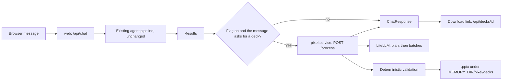

# Pixel slide service

> **Status: implemented for local Docker Compose (dev) and not yet run against a live model.** Everything here has only been exercised by a deterministic smoke build (`scripts/pixel_smoke.py`) and by reading the code. It is not in the DigitalOcean spec, so Stage does not run it. The layout and token design is in the [slide-generation spec](pixel-slide-generation-spec.md).

Pixel turns the team's results into a short slide deck as a `.pptx`. The model does the thinking (which slides, what each says, how to rate each item). Code does everything deterministic: fixed layouts and token schemas, validation between model calls, a hard call budget, and the file rendering.

## What changed in the identity rules

Pixel used to be a defined identity with no execution. These rules changed, and they are the only ones:

| Rule | Before | Now |
|---|---|---|
| Capabilities | `creative_design` (planned) | `creative_design` (still planned) and **`slide_generation` (implemented)** |
| Execution binding | none | `pixel` → `slide_generation` → service `pixel` in `execution_config/bindings.toml` |
| Operational services | six | seven: `pixel` fulfils `slide_generation` (`execution_bindings.OPERATIONAL_SERVICES`) |
| Model calls | none | the pixel service calls the LLM through LiteLLM with its own alias, `PIXEL_MODEL` |
| Prompt | persona plus a text slide style | persona only in `pixel.md`; task rules in `pixel/instructions.py`, composed like the other services |

Unchanged on purpose: Pixel still "cannot currently see, generate or edit images", still has "no tools beyond the text you are given", and a capability still grants no permission. The model gets no callable tools; code looks up layouts and frameworks and puts only what a call needs into its prompt. `tests/test_agent_identity.py` still pins those two statements.

## How it fits the Agent Constitution v1.0

- **2.2 / 2.3 Least and delegated authority.** Only an enabled repository binding authorizes the step (`pixel_authorized()`); a request cannot add or change it. The service can only read the results it is given and write a `.pptx`.
- **5.3 / 5.4 Delegation and communication.** Plain JSON REST, a validated `SpecialistResponse` envelope, and the request ID forwarded.
- **7.4 Prompt injection.** All supplied text, including other agents' output and the user's message, is marked untrusted in every prompt and in the task rules.
- **7.5 Tool execution.** No model-callable tools.
- **9.1 Centralized inference.** Every model call is `build_agent()` over LiteLLM; no provider SDK.
- **10.2 / 10.3 Budgets and waste.** At most `PIXEL_MAX_MODEL_CALLS` (default 8) model calls per deck, at most `PIXEL_TARGET_SLIDES` (default 6) slides planned, one retry per stage, and the whole feature behind the flag below.
- **3.1 Truthfulness, 11.1 Failure transparency.** Gaps are written `[to be supplied]`, capability claims are tagged `implemented` or `proposed`, compliance and certification phrasing is rejected, and a failed or partial deck is reported to the user, never hidden.
- **12.2 Amendments.** The Constitution itself is not amended. These are identity and binding changes, recorded here and in [identity execution integration](identity-execution-integration.md).

## The flag

`VIHARBOT_PPT_GENERATION_ENABLED` controls the whole feature. It is **true in local Compose for now**, to test Pixel's output, and both the web and pixel services read it.

- Code default: **false**. Compose default (`compose.yaml`) and `.env.example`: **true**.
- The DigitalOcean spec does not set it, so Stage never generates decks.
- **When the feature is finished, set it to false** in `compose.yaml` (the `:-true` defaults on `web` and `pixel`) and in your `.env`. With it false the web service never calls Pixel and the pixel service answers `503`, so no model calls are spent on decks.

## Workflow



1. The pipeline runs exactly as before (fixed, identity-routed or delegated; iterative mode answers through `/api/chat/stream` and does not build decks).
2. If the flag is on and the user's message names a deck (`slide deck`, `slides`, `PowerPoint`, `pptx`, `presentation`), the web service checks Pixel's binding and calls the pixel service with the question and the team's results as named evidence. The trigger is a fixed pattern, not a model call.
3. The pixel service plans a manifest (one model call), then fills slides in batches of up to six (one call per batch), validating after each call. A failed manifest or batch is retried once with the error text; slides that still fail are left out and reported.
4. Code renders the `.pptx` from the layout registry and the validated payloads. Badges carry both a colour and a text label.
5. The chat response gains a `deck` object (status, slide count, `download_url`, warnings, rejected slides, never slide text), and an agent-activity row for Pixel. A Pixel failure never fails the chat; it appears in `deck`.

## Comparing models

The branding kit is shared by construction: colors, fonts, layouts and badge labels come from `design_tokens.json`, `layouts.json` and `render.py`, and the model only writes token text and badge ratings. To compare models, replay one saved evidence set through each alias and compare the decks:

```bash
# save a /api/chat response once, then:
docker cp chat.json <pixel-container>:/tmp/chat.json
docker compose exec -e VIHARBOT_PPT_GENERATION_ENABLED=true pixel \
  python -m viharbot.pixel.compare --evidence /tmp/chat.json --out /data/compare \
  gemini/gemini-3.5-flash openai/gpt-5.4-mini
docker cp <pixel-container>:/data/compare ./compare
```

It prints one row per model (slides kept and left out, gap and over-limit counts, model calls, seconds) and writes `deck-<alias>.pptx` for each. Add `--all-layouts` to force one slide per registered layout (24): code plans the slides, so the model is never asked which layouts to use and only fills them, in four batches. Pair it with `scripts/pixel_lorem_chat.json`, a valid `/api/chat` response written entirely in Lorem Ipsum, so the content is neutral and every layout gets filled with text of realistic length (the run asks for 8 to 12 words per token instead of "[to be supplied]"). That run is about layout fit and per-model compliance with the word limits, not content quality. The model is chosen only here, never by a request. Each alias costs a few real model calls through LiteLLM, capped by `--max-calls`, and the tool refuses to run unless the PPT flag is true. A failing model is reported and the others still run.

## Limitations

- Not run against a real model. The planner and generator prompts, structured-output behaviour and typical slide quality are unverified.
- Slide visuals are one generic grid per layout. Nobody has looked at the rendered slides, and long text can overflow a cell.
- Deck generation takes several model calls and can take minutes; the web call allows 300 seconds. Public platforms that cut requests off sooner would need an asynchronous design.
- Finished decks contain the team's results and live in the pixel container's `MEMORY_DIR` (a named volume locally, `/tmp` on App Platform). Only the newest 20 are kept (`PIXEL_MAX_DECKS`). The pixel and web services are unauthenticated beyond the web login, like the other private agents.
- Only the non-streaming `/api/chat` path builds decks.
- Deck detection is a keyword pattern, so a message that merely mentions a presentation can trigger a deck while the flag is on.
- `PIXEL_MODEL` defaults to `gemini/gemini-3.5-flash` in Compose, the same alias Fact Check and Source Quality use, to follow Pixel's "Gemini multimodal family" preference. The identity's `preferred_model_family` is still only a description; the alias comes from the service environment. Slide quality on Gemini is checked only by one run.
- The Stage spec (`deploy/digitalocean/app.yaml`) deliberately has no pixel component; adding one is a cost change that needs your approval first.
